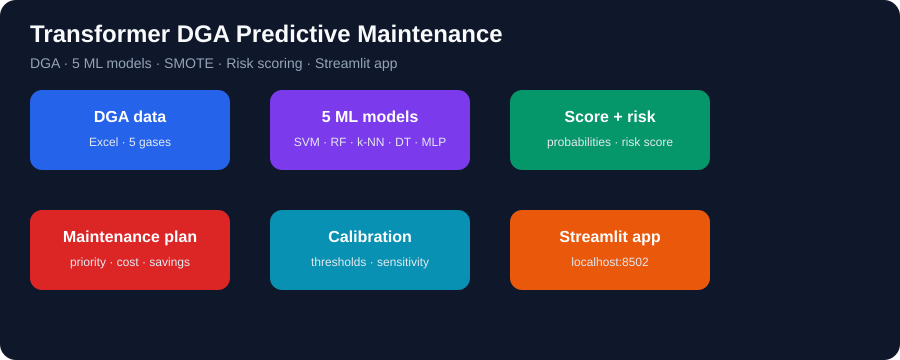
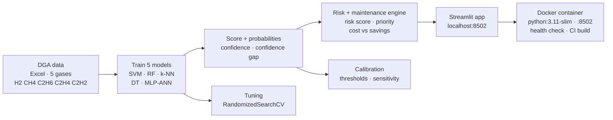
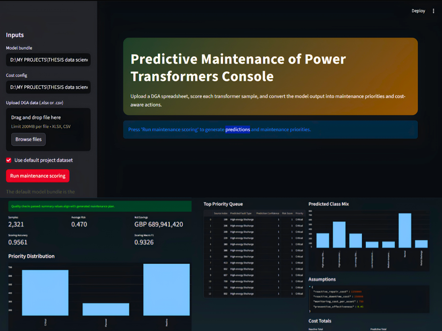

<div align="center">

# ⚡ Transformer DGA Predictive Maintenance

**Predict transformer faults before they fail — machine learning on dissolved gas analysis, with risk scoring and a maintenance plan. Containerized with Docker and built by CI, so the app runs the same anywhere.**


*Dissolved Gas Analysis (DGA) · 5 ML models · SMOTE · Risk scoring · Streamlit app · Docker · GitHub Actions CI*

Comprehensive Technical Manual and Thesis Alignment Guide

</div>

---

## ⚡ Quick Start (Read This First!)

### To Run the App Immediately:

```powershell
cd predictive-maintenance-power-transformers
.\run_app.bat
```

Then open your browser to: **http://localhost:8502**

That's it! The app is ready to use.

### Or run it with Docker (recommended — same environment everywhere):

```bash
docker compose up -d --build
```

Then open your browser to: **http://localhost:8502**

Stop it with `docker compose down`. See [🐳 Docker & DevOps](#-docker--devops) for the image, health check and CI details.

---

## 📑 Contents

- [Quick Start](#-quick-start-read-this-first)
- [Docker & DevOps](#-docker--devops)
- [Architecture](#️-architecture)
- [Screenshots](#️-screenshots)
- [1. Purpose of This README](#1-purpose-of-this-readme)
- [2. What This Project Actually Implements](#2-what-this-project-actually-implements)
- [3. Repository Layout and Responsibility](#3-repository-layout-and-responsibility)
- [4. Exact Runtime Dependencies](#4-exact-runtime-dependencies)
- [5. Data Contract (Hard Requirements)](#5-data-contract-hard-requirements)
- [6. Reproducibility Rules](#6-reproducibility-rules)
- [7. Baseline Training Pipeline](#7-baseline-training-pipeline)
- [8. Hyperparameter Tuning Pipeline](#8-hyperparameter-tuning-pipeline)
- [9. Inference and Scoring Pipeline](#9-inference-and-scoring-pipeline)
- [10. Maintenance Decision Engine](#10-maintenance-decision-engine)
- [11. Calibration and Sensitivity Module](#11-calibration-and-sensitivity-module)
- [12. Streamlit App (Operational UI)](#12-streamlit-app-operational-ui)
- [13. Output Files and Schemas](#13-output-files-and-schemas)
- [14. Current Verified Results Snapshot](#14-current-verified-results-snapshot)
- [15. Thesis Alignment Guide (Chapter by Chapter)](#15-thesis-alignment-guide-chapter-by-chapter)
- [16. Contradictions to Avoid in Thesis Text](#16-contradictions-to-avoid-in-thesis-text)
- [17. Known Limitations](#17-known-limitations)
- [18. Recommended Next Steps](#18-recommended-next-steps)
- [19. Minimal Command Runbook](#19-minimal-command-runbook)
- [20. Quick Audit Checklist Before Submission](#20-quick-audit-checklist-before-submission)

## 🏗️ Architecture





Data flows left to right: DGA gas readings are loaded and harmonized, five baseline models are trained (70/15/15 stratified split, SMOTE by default, best model by validation macro F1), scored samples get class probabilities, the maintenance engine turns predictions into a risk score, priority and expected cost/savings, and the Streamlit app presents it all for practical use. The whole app ships as a Docker container (see [Docker & DevOps](#-docker--devops)) — the same image is built and smoke-tested by CI on every push to `main`.

## 🖼️ Screenshots



*Live run of the Streamlit app: upload a DGA spreadsheet, run maintenance scoring, and see the results — 2,321 samples scored, average risk 0.470, scoring accuracy 0.9561, starting macro-F1 0.9326, net savings GBP 689,941,420, with the Top Priority Queue (mostly High-energy Discharge, Critical), Predicted Class Mix and Priority Distribution charts.*

---

## 🐳 Docker & DevOps

This is a DevOps project as well as an ML project: the app is containerized, and CI validates and builds it on every push.

### The image (`Dockerfile`)

| Detail | Value |
|---|---|
| Base image | `python:3.11-slim` |
| App code | `/app`, with `PYTHONPATH=/app/src` |
| Dependencies | Installed from `requirements.txt` with `--no-cache-dir` |
| Exposed port | `8502` |
| Health check | Every 30 s, hits `http://127.0.0.1:8502/_stcore/health` (20 s start period, 3 retries) |
| Start command | `streamlit run app/streamlit_app.py --server.address=0.0.0.0 --server.port=8502` |

### Run it (`docker-compose.yml`)

```bash
docker compose up -d --build   # build + start, port 8502:8502, restart unless-stopped
docker compose ps               # check the container is up (healthy)
docker compose logs -f          # follow the app logs
docker compose down             # stop and remove the container
```

The compose service is named `transformer-maintenance` and maps port `8502:8502`. `.dockerignore` keeps `.git`, `.venv`, caches and editor files out of the image.

### CI (`.github/workflows/ci.yml`)

Runs on every push to `main` and on pull requests, in two jobs:

| Job | What it does |
|---|---|
| `validate` | Installs Python 3.11 + dependencies, compiles all Python sources (`app`, `src`, `scripts`), and smoke-tests the trained model bundle (`outputs/models/best_model_bundle.joblib`) by loading it and printing its model name and labels |
| `docker` | Builds the Docker image with Buildx (`docker/build-push-action@v6`), after `validate` passes |

So a broken model bundle or a broken Dockerfile fails the pipeline before anything is deployed — the image is only built from validated code.

---


## 1. Purpose of This README

This document is intentionally extensive. It is both:

1. A technical specification of the implemented codebase.
2. A thesis-writing companion that maps implementation details to dissertation chapters.

If your thesis text conflicts with this document, the conflict should be treated as a contradiction against your current code.

## 2. What This Project Actually Implements

This codebase implements an end-to-end machine learning workflow for multiclass transformer fault diagnosis from Dissolved Gas Analysis (DGA), followed by a maintenance-prioritization and cost-impact module.

Primary capabilities:

1. Data ingestion from Excel, schema checks, and label harmonization.
2. Baseline model training and comparison across five algorithms.
3. Optional hyperparameter tuning via randomized search CV.
4. Batch scoring with class probabilities and confidence features.
5. Risk scoring and maintenance prioritization with configurable cost assumptions.
6. Threshold calibration for workload targeting.
7. Cost sensitivity analysis.
8. Streamlit interface for practical usage.
9. Containerized deployment with Docker (`Dockerfile`, `docker-compose.yml`) and CI validation + image build on every push (see [Docker & DevOps](#-docker--devops)).

Not implemented in this version:

1. Real-time online monitoring integration.
2. Time-series deep learning architecture.
3. Utility-validated accounting integration for cost assumptions.

## 3. Repository Layout and Responsibility

```
+ code/
+   app/
+     streamlit_app.py                 # UI layer
+   configs/
+     maintenance_defaults.json        # Decision and cost assumptions
+   data/
+     raw/
+       transformer-fault-dataset-main/
+         data.xlsx                    # Default training/scoring source
+   notebooks/
+     01_baseline_experiments.ipynb    # Interactive analysis notebook
+   outputs/
+     metrics/                         # Baseline metrics and reports
+     figures/                         # Confusion matrices
+     models/                          # Baseline model artifacts
+     predictions/                     # Scoring + maintenance outputs
+     tuning/                          # Tuning outputs
+     calibration/                     # Calibration + sensitivity outputs
+   src/
+     train_baselines.py               # Baseline training entrypoint
+     tune_models.py                   # Tuning entrypoint
+     score_maintenance.py             # Scoring + maintenance entrypoint
+     calibrate_maintenance.py         # Threshold calibration entrypoint
+     transformer_pm/
+       config.py                      # Global paths and schema constants
+       data.py                        # Data loading, preprocessing, split
+       modeling.py                    # Shared model/search/metric logic
+       inference.py                   # Bundle loading and scoring
+       maintenance.py                 # Risk/cost/priority engine
+       calibration.py                 # Threshold and sensitivity utilities
+   requirements.txt
+   run_app.ps1
+   run_app.bat
+   Dockerfile                     # python:3.11-slim, Streamlit on :8502, health check
+   docker-compose.yml             # service transformer-maintenance, 8502:8502
+   .dockerignore
+   .github/workflows/ci.yml       # validate (compile + model smoke test) then Docker build
+```

## 4. Exact Runtime Dependencies

From `requirements.txt`:

1. pandas>=2.3.0
2. numpy>=2.3.0
3. scikit-learn>=1.7.0
4. imbalanced-learn>=0.14.0
5. openpyxl>=3.1.0
6. matplotlib>=3.10.0
7. seaborn>=0.13.0
8. joblib>=1.5.0
9. jupyter>=1.1.0
10. streamlit>=1.44.0

Recommended setup:

```powershell
python -m venv .venv
.\.venv\Scripts\Activate.ps1
pip install -r requirements.txt
```

## 5. Data Contract (Hard Requirements)

Implemented in `src/transformer_pm/config.py` and `src/transformer_pm/data.py`.

### 5.1 Default source

`data/raw/transformer-fault-dataset-main/data.xlsx`

### 5.2 Required feature columns

Exactly 5 features are required and used in training and inference:

1. H2
2. CH4
3. C2H6
4. C2H4
5. C2H2

### 5.3 Label column resolution

Label candidates are:

1. Fault Type
2. 故障类型

Fallback behavior:

1. If neither candidate exists, the loader uses the last column as label.

### 5.4 Label harmonization map

Chinese labels are normalized to standardized English class names:

1. 正常 -> Normal
2. 高温过热 -> High-temperature Overheating
3. 中温过热 -> Medium-temperature Overheating
4. 低温过热 -> Low-temperature Overheating
5. 高能放电 -> High-energy Discharge
6. 低能放电 -> Low-energy Discharge
7. 局部放电 -> Partial Discharge

### 5.5 Missing and invalid values

1. Feature columns are converted using numeric coercion.
2. Rows missing any required feature are dropped.
3. Error is raised if resulting dataset is empty.
4. Error is raised if target has fewer than two classes.

## 6. Reproducibility Rules

From `src/transformer_pm/config.py`:

1. RANDOM_STATE = 42
2. TRAIN_RATIO = 0.70
3. VALIDATION_RATIO = 0.15
4. TEST_RATIO = 0.15

Split method in `split_dataset`:

1. Stratified train vs temporary split.
2. Stratified temporary split into validation and test.

Interpretation:

1. This is a fixed 70/15/15 stratified protocol.
2. Any thesis claim of 80/20 is contradictory to code.

## 7. Baseline Training Pipeline

Entrypoint: `src/train_baselines.py`

### 7.1 Trained models

1. svm_rbf
2. random_forest
3. knn
4. decision_tree
5. mlp_ann

### 7.2 Pipeline components

Per model, the pipeline can include:

1. StandardScaler (for scale-sensitive models).
2. SMOTE (enabled by default, disabled with `--no-smote`).
3. Final estimator.

### 7.3 Baseline model configurations

SVM:

1. kernel=rbf
2. C=10.0
3. gamma=scale
4. probability=True
5. class_weight=balanced

Random Forest:

1. n_estimators=400
2. class_weight=balanced_subsample
3. n_jobs=-1

k-NN:

1. n_neighbors=7
2. weights=distance

Decision Tree:

1. class_weight=balanced

MLP ANN (scikit-learn MLPClassifier):

1. hidden_layer_sizes=(128, 64)
2. max_iter=500
3. early_stopping=False

### 7.4 Evaluation metrics

On validation and test sets:

1. accuracy
2. precision_macro
3. recall_macro
4. f1_macro
5. f1_weighted
6. roc_auc_ovr_macro

### 7.5 Model selection rule

Best model is selected by maximum validation macro F1.

### 7.6 CLI

```powershell
.\.venv\Scripts\python.exe src\train_baselines.py
```

Options:

1. --data-path
2. --output-dir
3. --random-state
4. --no-smote

## 8. Hyperparameter Tuning Pipeline

Entrypoint: `src/tune_models.py`

### 8.1 Search design

1. Combines train and validation sets into a search pool.
2. Keeps the test set fully held out.
3. Uses RandomizedSearchCV with StratifiedKFold.
4. Default: cv_folds=3, n_iter=4.
5. Objective: f1_macro.

### 8.2 Search-space implementation

Search spaces are defined in `src/transformer_pm/modeling.py` via `build_tuning_search_space`.

### 8.3 CLI

```powershell
.\.venv\Scripts\python.exe src\tune_models.py
```

Useful options:

1. --cv-folds 3
2. --n-iter 4
3. --models random_forest knn
4. --no-smote

### 8.4 Tuning artifact outputs

1. metrics/tuned_model_summary.csv
2. metrics/tuned_model_summary_partial.csv
3. metrics/best_params_<model>.json
4. metrics/comparison_vs_baseline.csv
5. metrics/tuning_config.json
6. search/cv_results_<model>.csv
7. models/best_tuned_model_bundle.joblib

## 9. Inference and Scoring Pipeline

Entrypoint: `src/score_maintenance.py`

### 9.1 Bundle contract

The loaded bundle contains:

1. model
2. model_name
3. feature_columns
4. target_column
5. labels
6. use_smote

### 9.2 Output columns added during scoring

1. Predicted Fault Type
2. Prediction Confidence
3. Confidence Gap
4. prob_<normalized_label> for each class label
5. Actual Fault Type (if source labels available)
6. Correct Prediction (if Actual Fault Type exists)

### 9.3 Confidence definitions

1. Prediction Confidence = max class probability.
2. Confidence Gap = (top probability - second-highest probability).

### 9.4 CLI

```powershell
.\.venv\Scripts\python.exe src\score_maintenance.py
```

Options:

1. --input-path
2. --model-bundle
3. --cost-config
4. --output-dir

## 10. Maintenance Decision Engine

Core file: `src/transformer_pm/maintenance.py`

Config source: `configs/maintenance_defaults.json`

### 10.1 Core concepts

1. Predicted severity score (mapped from predicted class).
2. Expected fault event multiplier (probability-weighted).
3. Expected severity score (probability-weighted).
4. Composite risk score.
5. Priority mapping by thresholds.
6. Priority-specific action and response target.
7. Expected reactive vs predictive cost and estimated savings.

### 10.2 Formula definitions

Risk score:

$$
\text{RiskScore} = 0.75 \times \text{ExpectedFaultEventMultiplier} + 0.25 \times \text{PredictionConfidence} \times \text{PredictedSeverityScore}
$$

Reactive ceiling:

$$
\text{ReactiveCostCeiling} = \text{repair_cost} + \text{downtime_cost}
$$

Expected reactive cost:

$$
\text{ExpectedReactiveCost} = \text{RiskScore} \times \text{ReactiveCostCeiling}
$$

Expected predictive cost:

$$
\text{ExpectedPredictiveCost} = \text{monitoring_cost_per_asset} + \text{planned_intervention_cost(priority)} + \text{ExpectedReactiveCost} \times (1 - \text{preventive_effectiveness})
$$

Estimated savings:

$$
\text{EstimatedSavings} = \text{ExpectedReactiveCost} - \text{ExpectedPredictiveCost}
$$

### 10.3 Default decision assumptions

From `configs/maintenance_defaults.json`:

1. Priority thresholds
   1. critical: 0.7
   2. urgent: 0.5
   3. planned: 0.25
2. Response target hours
   1. Critical: 4
   2. Urgent: 24
   3. Planned: 168
   4. Routine: 720
3. Reactive strategy
   1. repair_cost: 1,250,000
   2. downtime_cost: 250,000
4. Predictive strategy
   1. monitoring_cost_per_asset: 750
   2. preventive_effectiveness: 0.45

## 11. Calibration and Sensitivity Module

Entrypoint: `src/calibrate_maintenance.py`

Core functions: `src/transformer_pm/calibration.py`

### 11.1 Threshold calibration logic

Input:

1. Scored dataset with risk scores.
2. Target shares for Critical, Urgent, Planned.

Method:

1. Compute quantiles of risk distribution for each cumulative target.
2. Enforce monotonic ordering between thresholds.
3. Write updated threshold config and calibrated plan.

### 11.2 Default target shares

1. Critical = 0.15
2. Urgent = 0.20
3. Planned = 0.25

### 11.3 Sensitivity table

Grid used in current implementation:

1. monitoring_cost_per_asset in [250, 500, 750, 1000, 1500]
2. preventive_effectiveness in [0.25, 0.35, 0.45, 0.55, 0.65]

Output size:

1. 25 scenario rows.

### 11.4 CLI

```powershell
.\.venv\Scripts\python.exe src\calibrate_maintenance.py
```

Options:

1. --scored-path
2. --cost-config
3. --output-dir
4. --critical-share
5. --urgent-share
6. --planned-share

## 12. Streamlit App (Operational UI)

File: `app/streamlit_app.py`

### 12.1 User workflow

1. Choose model bundle path.
2. Choose cost config path.
3. Upload input file or use default dataset.
4. Click Run maintenance scoring.
5. Inspect summary metrics and charts.
6. Export scored samples and maintenance plan.

### 12.2 Displayed metrics

1. Samples
2. Average Risk
3. Net Savings
4. Critical Assets
5. Scoring Accuracy (when labels exist)
6. Scoring Macro F1 (when labels exist)

### 12.3 Launch scripts

PowerShell launcher (`run_app.ps1`): supports custom port and headless flag.

Batch launcher (`run_app.bat`): supports start and stop behavior by port.

## 13. Output Files and Schemas

### 13.1 Baseline training outputs

Location: `outputs/metrics`, `outputs/figures`, `outputs/models`

Key files:

1. model_summary.csv
2. experiment_config.json
3. classification_report_val_<model>.txt
4. classification_report_test_<model>.txt
5. confusion_matrix_val_<model>.png
6. confusion_matrix_test_<model>.png
7. <model>.joblib
8. best_model_bundle.joblib

### 13.2 Scoring outputs

Location: `outputs/predictions`

Key files:

1. scored_samples.csv
2. maintenance_plan.csv
3. maintenance_summary.json
4. scoring_evaluation.json (if labels exist)
5. classification_report_scoring.txt (if labels exist)

### 13.3 Tuning outputs

Location: `outputs/tuning`

Key files:

1. metrics/tuned_model_summary.csv
2. metrics/comparison_vs_baseline.csv
3. metrics/tuning_config.json
4. search/cv_results_<model>.csv
5. models/best_tuned_model_bundle.joblib

### 13.4 Calibration outputs

Location: `outputs/calibration`

Key files:

1. calibrated_maintenance_config.json
2. calibrated_maintenance_plan.csv
3. calibration_report.json
4. cost_sensitivity_analysis.csv

## 14. Current Verified Results Snapshot

All values below are copied from generated output artifacts already present in this repository.

### 14.1 Experiment configuration

From `outputs/metrics/experiment_config.json`:

1. samples_total: 2321
2. features: [H2, CH4, C2H6, C2H4, C2H2]
3. classes: 7
4. split sizes: train=1624, validation=348, test=349
5. use_smote: true
6. best_model: random_forest

### 14.2 Baseline test metrics

From `outputs/metrics/model_summary.csv`:

1. random_forest: accuracy=0.8596, recall_macro=0.7917, f1_macro=0.7840
2. knn: accuracy=0.8223, recall_macro=0.7426, f1_macro=0.7290
3. mlp_ann: accuracy=0.7966, recall_macro=0.7381, f1_macro=0.7255
4. decision_tree: accuracy=0.7679, recall_macro=0.6841, f1_macro=0.6729
5. svm_rbf: accuracy=0.5330, recall_macro=0.4752, f1_macro=0.4539

### 14.3 Scoring metrics on labeled input

From `outputs/predictions/scoring_evaluation.json`:

1. accuracy: 0.9561
2. precision_macro: 0.9285
3. recall_macro: 0.9373
4. f1_macro: 0.9326
5. f1_weighted: 0.9563

### 14.4 Maintenance summary

From `outputs/predictions/maintenance_summary.json`:

1. average_risk_score: 0.4699
2. priority_counts:
   1. Routine: 738
   2. Critical: 666
   3. Urgent: 638
   4. Planned: 279
3. estimated_net_savings: 689,941,420.44 GBP

### 14.5 Calibration summary

From `outputs/calibration/calibration_report.json`:

1. calibrated_thresholds:
   1. critical: 0.783438
   2. urgent: 0.679969
   3. planned: 0.429338
2. achieved_priority_mix:
   1. Critical: 0.1499
   2. Urgent: 0.1995
   3. Planned: 0.2503
   4. Routine: 0.4003
3. estimated_net_savings: 706,908,670.73 GBP
4. sensitivity_analysis_rows: 25

### 14.6 Tuning snapshot

From `outputs/tuning/metrics/tuning_config.json`:

1. cv_folds: 3
2. n_iter_per_model: 4
3. best_model: random_forest

From `outputs/tuning/metrics/comparison_vs_baseline.csv`:

1. Tuning did not universally improve all models.
2. random_forest tuned test_f1_macro (0.7616) is below baseline random_forest test_f1_macro (0.7840).

## 15. Thesis Alignment Guide (Chapter by Chapter)

### 15.1 Chapter 1 (Introduction)

Use:

1. Section 2 for project scope.
2. Section 10 for operations relevance.
3. Section 12 for deployable artifact angle.

### 15.2 Chapter 2 (Literature)

Use this repo to support:

1. Multiclass supervised learning in DGA.
2. Class imbalance handling via SMOTE.
3. Practical decision-support integration.

Do not cite this repo as external literature; use it as implementation evidence.

### 15.3 Chapter 3 (Methodology)

Use Sections 5 through 11 directly:

1. Data contract and preprocessing.
2. Split design and reproducibility.
3. Model family and metrics.
4. Tuning protocol.
5. Maintenance formula and thresholds.
6. Calibration and sensitivity method.

### 15.4 Chapter 4 (Implementation)

Use Sections 3, 7, 8, 10, 11, 12, 13:

1. Module responsibilities.
2. Script execution flow.
3. Output artifact generation.

### 15.5 Chapter 5 (Results)

Use Section 14 plus raw artifacts from outputs/ folders.

### 15.6 Chapter 6 (Discussion and Conclusion)

Use:

1. Section 14 for evidence-based claims.
2. Section 16 for limitations.
3. Section 17 for future work.

## 16. Contradictions to Avoid in Thesis Text

These are common mismatch points between narrative and code:

1. Claiming customer churn domain.
2. Claiming 7 input gases in implemented pipeline.
3. Claiming 80/20 split instead of 70/15/15.
4. Claiming Keras/TensorFlow ANN for executed baseline runs.
5. Claiming 10-fold GridSearchCV as executed tuning protocol.
6. Leaving [TBC] placeholders when output values exist.

## 17. Known Limitations

1. Current model input excludes CO and CO2.
2. Cost assumptions are configurable but not utility-audited.
3. Tuning defaults are intentionally lightweight.
4. Workflow is batch and offline.
5. Per-class performance remains weaker on some lower-support classes.

## 18. Recommended Next Steps

Engineering:

1. Add unit tests for data validation, scoring, and cost formulas.
2. Add probability calibration diagnostics and optional calibration models.
3. Expand feature set when reliable CO/CO2 data is available.
4. Add explainability outputs for operator trust.

Research:

1. Validate on additional external transformer datasets.
2. Compare threshold policies under constrained maintenance capacity.
3. Evaluate effect of stronger tuning budgets and nested CV.
4. Quantify uncertainty in financial estimates using Monte Carlo scenarios.

## 19. Minimal Command Runbook

Run from `code/`.

Baseline training:

```powershell
.\.venv\Scripts\python.exe src\train_baselines.py
```

Tuning:

```powershell
.\.venv\Scripts\python.exe src\tune_models.py
```

Scoring + maintenance plan:

```powershell
.\.venv\Scripts\python.exe src\score_maintenance.py
```

Calibration + sensitivity:

```powershell
.\.venv\Scripts\python.exe src\calibrate_maintenance.py
```

Streamlit app:

```powershell
.\.venv\Scripts\python.exe -m streamlit run app\streamlit_app.py --server.port 8502
```

## 20. Quick Audit Checklist Before Submission

1. No mention of customer churn.
2. Features listed as 5 implemented gases.
3. Split listed as 70/15/15.
4. ANN described as sklearn MLP in executed baseline.
5. Tuning described as RandomizedSearchCV with 3 folds and n_iter=4 for saved run.
6. Reported metrics copied from outputs files, not placeholders.
7. Cost equations match `maintenance.py` implementation.

---

If you keep your thesis aligned to this README, your narrative will remain synchronized with your executable code and generated artifacts.
